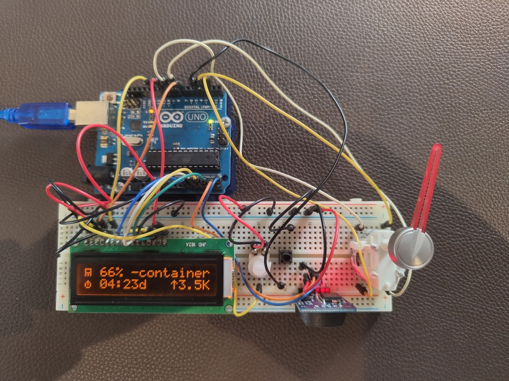
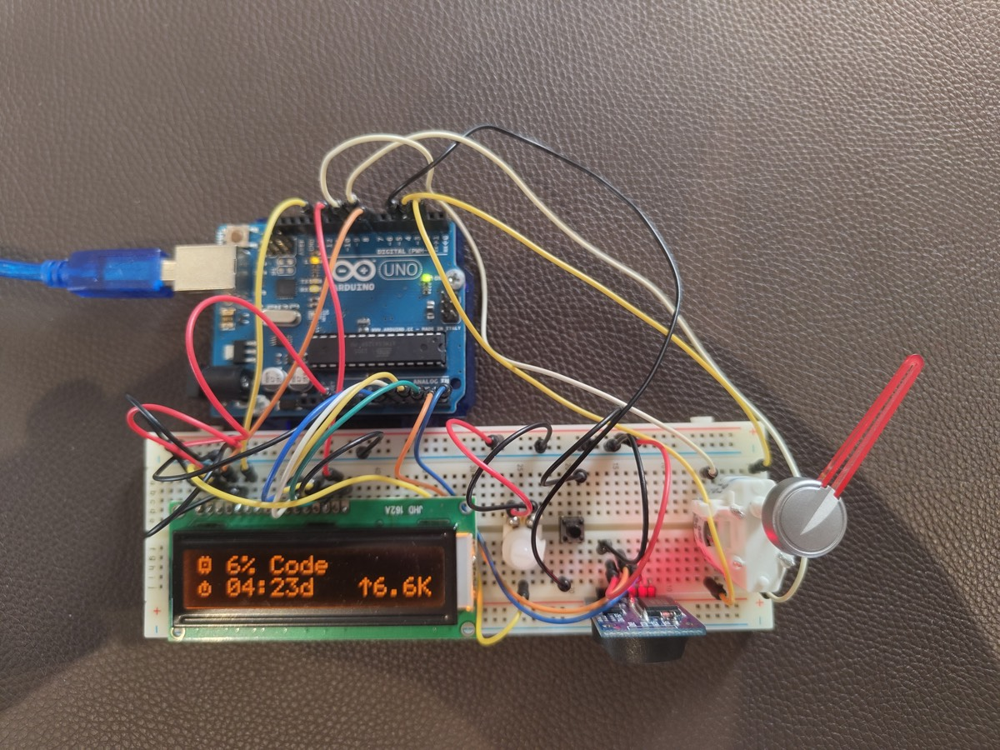
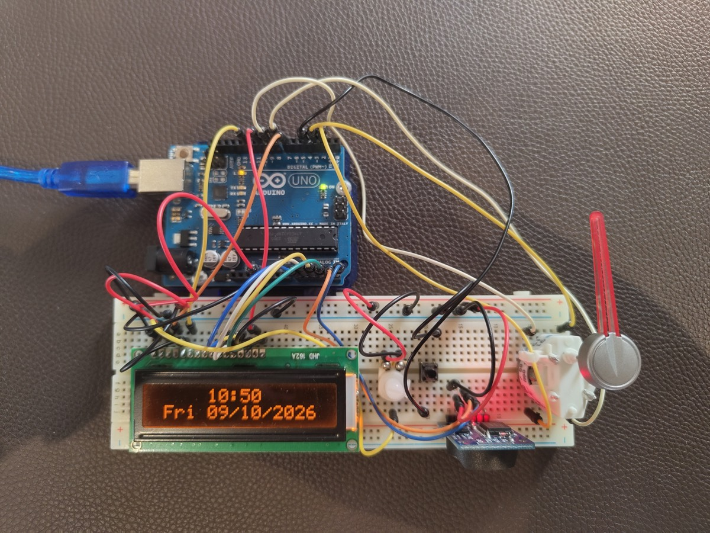
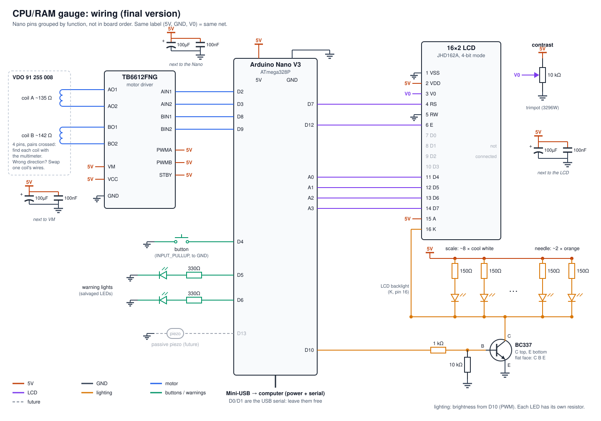

# CPU/RAM gauge

A needle gauge salvaged from a car instrument cluster that shows your computer's
CPU or RAM usage. A Python script reads the system stats and sends them over
serial to an Arduino, which drives the needle's stepper motor and a 16×2 LCD.
The script decides what is shown; the Arduino is the physical part, plus what
must work without the computer (clock, Pomodoro, parking).

- **Needle:** CPU or RAM usage. A button toggles between them.
- **LCD:** the other metric and the app using the most of it, uptime and
  network speed (download or upload, whichever is faster). Above 60% CPU or
  80% RAM on the needle, uptime and network give way to the app behind it and
  its share.
- Parks the needle at 0% and turns the LCD off when the computer's screen
  sleeps or the script stops.
- **Clock (optional DS3231 module):** with no data the needle shows the
  minutes and the LCD the time and date; the script keeps it set.
- **Email (optional):** each new unread message shows on the LCD (sender and
  subject, scrolling) until it has scrolled through once.
- **Pomodoro:** the needle runs from 100% to 0% through each focus and break,
  with the time left on the LCD and a piezo beep at the end. Durations, tone
  and volume are set at the top of `pc/gauge.py`.
- **Plugins:** what the needle and the LCD show comes from small Python plugins
  in `pc/plugins/`; new metrics or LCD content need no firmware change.

## Prototype


*Prototyping board showing CPU usage on the needle; the LCD shows RAM.*


*Prototyping board showing RAM usage on the needle; the LCD shows CPU.*


*Prototyping board showing the clock: the needle marks the minutes.*

## Hardware

- VDO/Siemens **91 255 008** instrument-cluster stepper motor
- Arduino Uno or Nano (ATmega328P)
- 16×2 HD44780 LCD (4-bit mode) and a 10 kΩ contrast trimpot
- Push button, and a passive piezo for the Pomodoro
- Recommended: TB6612FNG motor driver. Wiring the motor straight to the Arduino
  pins is only for bench tests.

| Pin | Function |
|---|---|
| D2, D3 | motor, coil A |
| D8, D9 | motor, coil B |
| D4 | main button, to ground |
| D13 | passive piezo |
| D7, D12 | LCD RS, E |
| A0–A3 | LCD D4–D7 |
| D10 | LCD backlight / lighting (PWM) |



The full pin map, wiring, current budget and bill of materials are in
[NOTES.md](NOTES.md).

## Layout

| Path | Contents |
|---|---|
| `firmware/gauge/` | Final Arduino sketch |
| `firmware/step_counter/` | Bench sketch to drive the motor from the Serial Monitor (19200 baud) and calibrate it |
| `pc/gauge.py` | PC script that sends the readings and LCD text; settings at the top |
| `pc/plugins/` | What the needle and the LCD show: CPU/RAM, uptime/network, email |
| `pc/lcd.py` | LCD helpers shared by the plugins: scrolling, accents, custom characters |
| `tests/` | Tests that run on the computer, no Arduino needed (`tests/run.sh`) |
| `docs/wiring.svg` | Wiring diagram (generated by `docs/wiring.py`) |
| `docs/perfboard.svg` | Perfboard layout (generated by `docs/perfboard.py`) |
| `docs/images/` | Photos of the prototype |
| `NOTES.md` | Design notes, bench results, serial protocol, electronics and to-do list |

## Usage

1. Upload `firmware/gauge/gauge.ino` to the Arduino (needs the `LiquidCrystal`
   library, bundled with the Arduino IDE).
2. Install the PC dependencies and run the script:

   ```sh
   pip install -r pc/requirements.txt
   python3 pc/gauge.py            # auto-detects the Arduino
   python3 pc/gauge.py --port /dev/cu.usbmodem101 -v
   ```

The script runs on macOS and Linux. It also runs on Windows, but can't detect
when the screen is asleep.

### Email

Copy `.env.example` to `.env` (kept out of git) and fill in the IMAP account; for
Gmail, an app password. Without it the email plugin stays off. The layout is set in
`PLUGINS` at the top of `pc/gauge.py`:

```python
Email(rows=("{icon} {count}", "{sender} - {subject}"))  # "3 new emails" on row 0
Email(rows=(None, "{sender} - {subject}"))              # row 1 only; row 0 keeps CPU/RAM
```

It checks every minute and never marks anything as read. New mail shows one at a
time, for 5 s or until its row has scrolled through. `{count}` is how many came in
this batch, the same while they show. After a Pomodoro or the computer sleeping,
only the 3 newest show; the count includes the rest.

### Plugins

`PLUGINS` at the top of `pc/gauge.py` lists them. A click moves the needle to the
next of their needles, in list order; each LCD row shows the first plugin in the
list with something for it. A plugin is a class in `pc/plugins/` that overrides
what it needs from `Plugin` (`pc/plugins/__init__.py`): `needles`, `update()` with
its `interval`, `rows()`, `start()`, `resume()`. Plugins rest while the computer's
screen sleeps and during the Pomodoro. Custom characters come from `lcd.glyph()`:
the script loads them into the LCD's 8 slots only while they're shown.

### Button

The main button acts on release; while it's held the LCD shows what releasing
will do.

- **Short press:** the needle's next metric (CPU, RAM: the plugins' needles). In
  the Pomodoro: start/pause, or start the next phase once one is over.
- **Hold 1 s:** start or leave the Pomodoro.
- **Hold 3 s:** 0 → 100 → 0 sweep (self-test), 1 s at the top and 1 s at zero, with every LCD
  pixel on and a beep.
- **Hold while powering up:** force a full homing against the end stop.

## Tests

```sh
tests/run.sh
```

Runs `pc/gauge.py` against a fake serial port, and `firmware/gauge/gauge.ino` on
the computer against a simulated Arduino (time, buttons, LCD, serial): buttons,
Pomodoro, lamp test, parking. Needs the Arduino IDE (for its `arduino-cli`) and a
C++ compiler (Xcode command line tools on macOS).

## Calibration

The motor has no public datasheet, so its parameters were measured on the bench
with `step_counter`: 290 half-steps between end stops, and `HOME_PHASE = 6`.
**Recalibrate `HOME_PHASE` if the motor wiring changes.** [NOTES.md](NOTES.md)
has the procedure.

**Never turn the needle shaft by hand:** it damages the motor's internal
gearbox.

## Notes

[NOTES.md](NOTES.md) records how the project got here: how the motor was
identified, bench measurements, design decisions, the serial protocol, EEPROM
layout and what's left to do.
